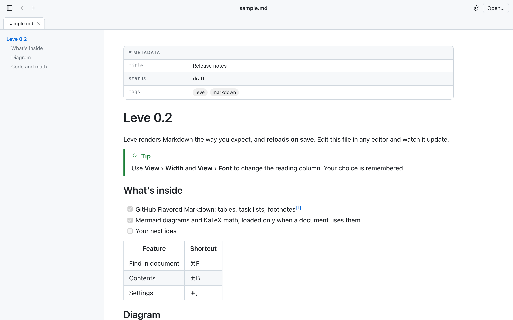

<p align="center">
  
</p>

<h1 align="center">Leve</h1>

<p align="center">
  <strong>Double-click a <code>.md</code> file and it just looks right.</strong><br>
  A small, fast, private Markdown viewer for macOS and Windows. Save in your editor and Leve reloads.
</p>

<p align="center">
  <a href="https://github.com/moraliasp/leve/releases/latest"></a>
  
  <a href="LICENSE"></a>
</p>

<p align="center">
  <a href="https://github.com/moraliasp/leve/releases/latest"><strong>Download</strong></a> ·
  <a href="#first-launch">First launch</a> ·
  <a href="docs/sample.md">Sample document</a> ·
  <a href="README.pt-BR.md">Português</a>
</p>

<p align="center">
  <picture>
    <source media="(prefers-color-scheme: dark)" srcset="docs/img/screenshot-en-dark.png">
    
  </picture>
</p>

## Download

Get the latest version from [Releases](https://github.com/moraliasp/leve/releases/latest):

- **macOS 11+** (Apple silicon and Intel): `Leve_x.y.z_universal.dmg`
- **Windows 10/11** (x64): `Leve_x.y.z_x64-setup.exe` (per-user, no admin) or `.msi`

Each release lists SHA-256 checksums in `SHA256SUMS.txt` and carries [build provenance attestations](https://github.com/moraliasp/leve/attestations) (`gh attestation verify <file> --repo moraliasp/leve`).

### First launch

Leve isn't signed with an Apple or Microsoft certificate yet, so the system warns you once.
**macOS:** open Leve, click *Done*, then go to *System Settings › Privacy & Security* and click *Open Anyway* (or run `xattr -dr com.apple.quarantine /Applications/Leve.app`).
**Windows:** in the SmartScreen prompt, click *More info › Run anyway*.

Updates are signed separately and verified by the app before installing: *Leve › Check for Updates…* (on Windows, *Help › Check for Updates…*), or turn on the daily check in *Settings*.

## Features

- GitHub Flavored Markdown: tables, task lists, footnotes, alerts (`> [!NOTE]`) and Obsidian callouts
- Syntax highlighting, Mermaid diagrams and KaTeX math, loaded only when a document needs them
- Front matter as a table, `[[wikilinks]]`, relative links and images
- Table of contents, find in document, tabs, back/forward
- Light and dark themes, three reading widths, three fonts, zoom
- Print or export to PDF; export a self-contained HTML file (offline, no scripts) or copy it as HTML
- English and Portuguese, following your system or your choice in *Settings*
- Large documents (up to 20 MB) open in a lighter mode
- A built-in Markdown primer opens when you start Leve with nothing else to show (*Help › Sample Document*; can be turned off in *Settings*)

## Privacy

No telemetry. Leve reads only files you open (dialog, double-click, drag and drop) and files an open document links to with a relative path. Remote images are blocked until you load them. The network is used only for links you open, remote images you ask for, and update checks.

## Build

Requirements: Node 22+, pnpm, stable Rust, and Xcode Command Line Tools (macOS) or Visual Studio Build Tools + WebView2 (Windows).

```bash
pnpm install
pnpm tauri dev -- -- docs/sample.md   # run with a document
pnpm test                              # unit and golden tests
pnpm tauri build                       # .app/.dmg on macOS, .exe/.msi on Windows
```

From a Mac you can also build the Windows NSIS installer with `pnpm build:windows` (needs `cargo-xwin`, `llvm`, `lld` and `makensis`; see `scripts/build-windows.sh`).

Contributions are welcome: see [CONTRIBUTING.md](CONTRIBUTING.md). Design decisions (in Portuguese) live in [`docs/decisoes.md`](docs/decisoes.md).

## License

Code under the [MIT license](LICENSE), © 2026 Moralia. Third-party notices: [THIRD_PARTY_NOTICES.md](THIRD_PARTY_NOTICES.md) and [THIRD_PARTY.md](THIRD_PARTY.md).

**Trademark:** the Leve name, logo and the Moralia brand are not licensed under MIT. If you distribute a fork, please use a different name and icon.
