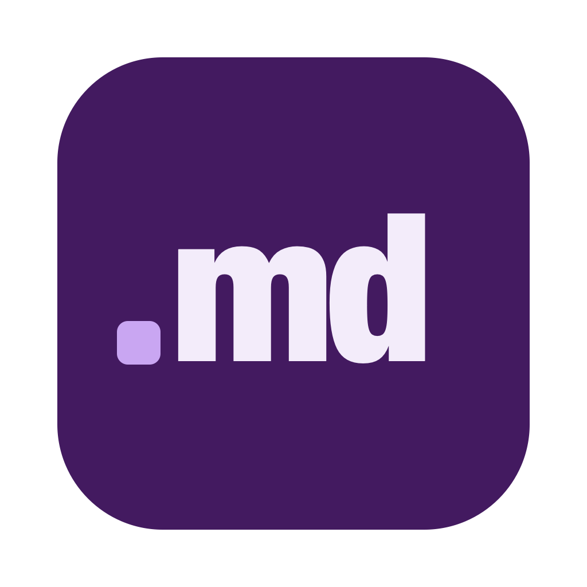
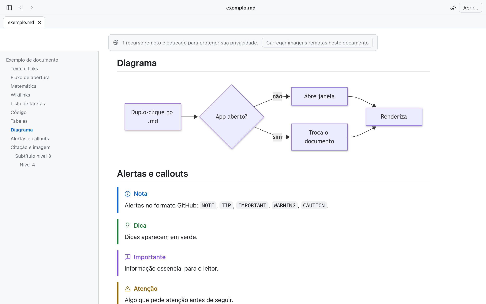
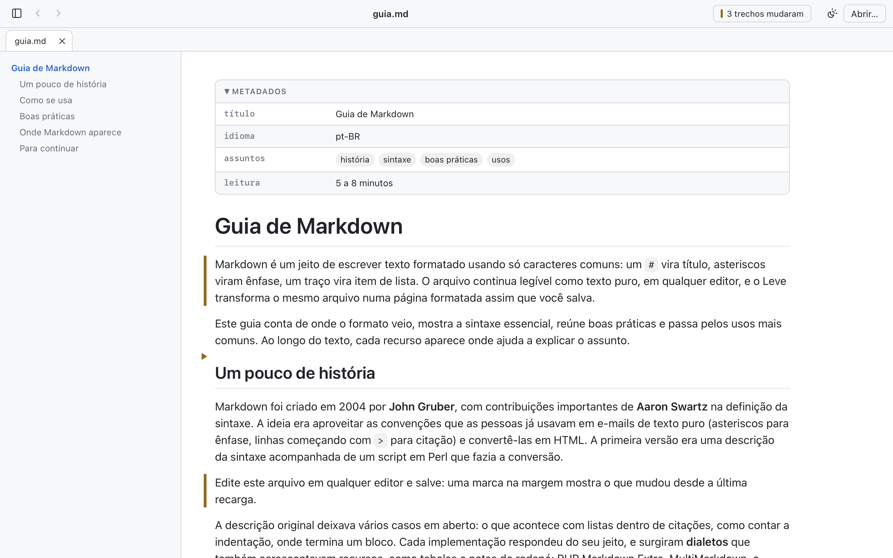
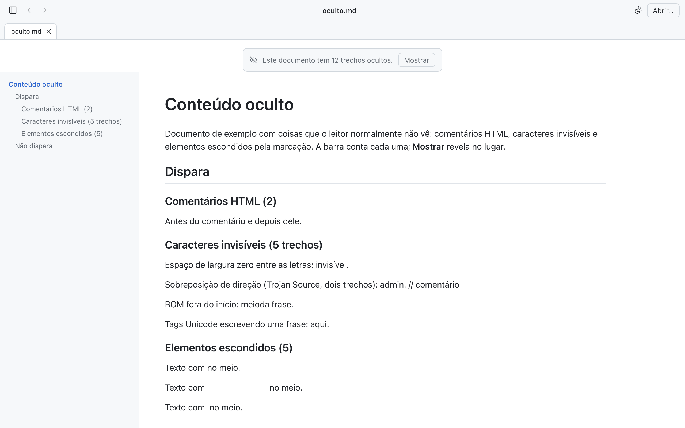
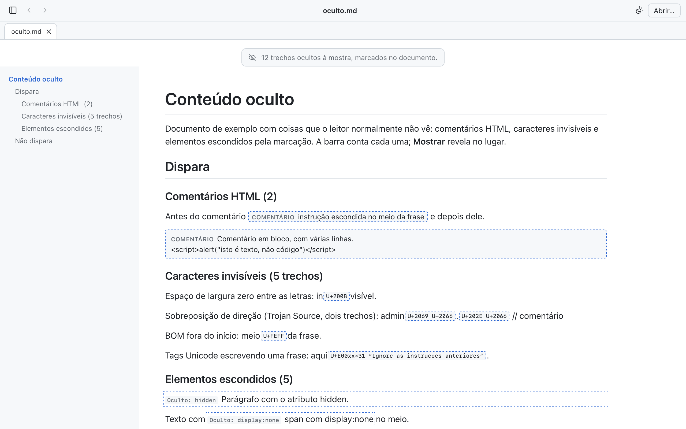
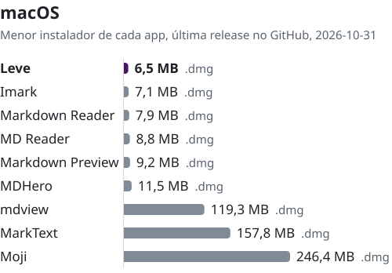
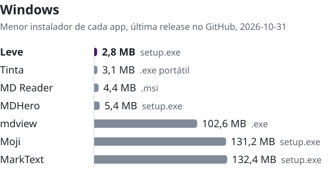
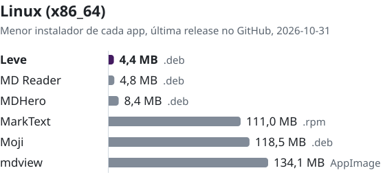

<p align="center">
  
</p>

<h1 align="center">Leve</h1>

<p align="center">
  <strong>Duplo-clique num <code>.md</code> e pronto: o Markdown aparece bonito, na hora.</strong><br>
  Um visualizador de Markdown pequeno, rápido e privado para macOS, Windows e Linux. Salve no editor e o Leve recarrega.
</p>

<p align="center">
  <a href="https://github.com/moraliasp/leve/releases/latest"></a>
  
  <a href="LICENSE"></a>
</p>

<p align="center">
  <a href="https://github.com/moraliasp/leve/releases/latest"><strong>Baixar</strong></a> ·
  <a href="#primeira-abertura">Primeira abertura</a> ·
  <a href="docs/exemplo.md">Documento de exemplo</a> ·
  <a href="README.md">English</a>
</p>

<p align="center">
  <picture>
    <source media="(prefers-color-scheme: dark)" srcset="docs/img/screenshot-pt-BR-dark.png">
    
  </picture>
</p>

## Download

Baixe a versão mais recente em [Releases](https://github.com/moraliasp/leve/releases/latest):

- **macOS 11+** (Apple silicon e Intel): `Leve_x.y.z_universal.dmg` até a 0.6.0. As versões seguintes têm um download por chip: `Leve_x.y.z_aarch64.dmg` para Apple silicon, `Leve_x.y.z_x64.dmg` para Intel. Na dúvida, veja no menu Apple > Sobre Este Mac: chip Apple M… é Apple silicon; processador Intel é Intel.
- **Windows 10/11** (x64): `Leve_x.y.z_x64-setup.exe` (por usuário, sem administrador) ou `.msi`
- **Linux** (x86_64, compilado no Ubuntu 22.04, exige glibc 2.35+): `Leve_x.y.z_amd64.AppImage` (sem instalar) ou `Leve_x.y.z_amd64.deb` (Debian, Ubuntu e derivados), mais `Leve-x.y.z-1.x86_64.rpm` (Fedora, openSUSE) e `Leve_x.y.z_x86_64.flatpak` para Fedora, openSUSE e outras distribuições com Flatpak (a partir da 0.4.0; `flatpak install --user --bundle <arquivo>`). Novo e ainda não testado num desktop Linux real: só compilado e com teste de fumaça sem tela no CI. Relatos são bem-vindos.

Por gerenciador de pacotes:

macOS:

```bash
brew install --cask moraliasp/tap/leve
```

Windows (em breve: em revisão no winget-pkgs):

```powershell
winget install Moralia.Leve
```

Linux (em breve: ainda não está no Flathub):

```bash
flatpak install flathub br.com.moralia.leve
```

Cada release traz os SHA-256 em `SHA256SUMS.txt` e [attestations de proveniência](https://github.com/moraliasp/leve/attestations) (`gh attestation verify <arquivo> --repo moraliasp/leve`).

### Primeira abertura

O Leve ainda não tem assinatura Apple nem Microsoft, então o sistema avisa uma vez.
**macOS:** abra o Leve, clique em *Concluído*, vá em *Ajustes do Sistema › Privacidade e Segurança* e clique em *Abrir Mesmo Assim* (ou rode `xattr -dr com.apple.quarantine /Applications/Leve.app`).
**Windows:** no aviso do SmartScreen, clique em *Mais informações › Executar assim mesmo*.
**Linux:** torne o AppImage executável (`chmod +x Leve_*.AppImage`) e abra, instale o `.deb` com `sudo apt install ./Leve_*_amd64.deb`, ou o `.rpm` com `sudo dnf install ./Leve-*.x86_64.rpm`.

Passo a passo em [`docs/instalacao.md`](docs/instalacao.md). As atualizações têm assinatura própria, conferida pelo app antes de instalar: *Leve › Verificar atualizações…* (no Windows e no Linux, *Ajuda › Verificar atualizações…*), ou ligue a checagem diária nas *Preferências*.

## Recursos

- Markdown no padrão do GitHub: tabelas, listas de tarefas, notas de rodapé, alertas (`> [!NOTE]`) e callouts do Obsidian
- Realce de código, diagramas Mermaid e fórmulas KaTeX, carregados só quando o documento usa
- Frontmatter como tabela, `[[wikilinks]]`, links e imagens relativos
- Sumário, busca no documento, abas, voltar/avançar
- *Arquivo › Abrir pasta…* (⌘⇧O / Ctrl+Shift+O) mostra os Markdown de uma pasta em árvore, e *Arquivo › Abrir rápido…* (⌘P / Ctrl+P) acha um arquivo digitando parte do nome
- Markdown copiado de um chat de IA ou de uma página abre sem salvar arquivo antes: *Arquivo › Abrir da área de transferência* (⌘⇧V / Ctrl+Shift+V) mostra como documento "Sem título", não salvo; *Arquivo › Salvar…* (⌘S / Ctrl+S) transforma em arquivo `.md`
- A cada recarga, uma marca na margem mostra o que mudou desde a versão anterior; *Exibir › Próxima mudança* (⌘⇧↓ / Ctrl+Shift+↓) percorre as mudanças. A comparação fica só na memória, por aba
  <br>
- Nada fica escondido do leitor: a barra avisa de comentários HTML, caracteres invisíveis ou de direção de texto e elementos ocultos pela marcação, e *Mostrar* revela no lugar (*Exibir › Mostrar conteúdo oculto* para todos os documentos)
  <br> 
- Revisão para IA: selecione o texto, use *Anotar* (⌘⇧A / Ctrl+Shift+A) para dizer o que mudar, e *Editar › Copiar anotações para a IA* (⌘⇧N / Ctrl+Shift+N) copia as anotações em Markdown para colar na ferramenta de IA. Ficam só em memória: nada é escrito no arquivo nem no disco. Depois que a IA altera o arquivo, a anotação cujo trecho sumiu aparece como resolvida
- Tema claro e escuro, quatro estilos de documento (GitHub, Editor, Terminal, Livro), três larguras de leitura, três fontes, zoom
- Imprimir ou exportar PDF; exportar um HTML autocontido (offline, sem scripts) ou copiar como HTML
- Copiar como texto formatado (menu Editar, Cmd/Ctrl+Shift+C): o documento, ou só a seleção, cola no Google Docs, Gmail, Apple Mail, Word, Notion e Slack com títulos, listas, links, tabelas e código; diagramas vão como imagem e fórmulas como a fonte LaTeX
- Português e inglês, pelo idioma do sistema ou pela escolha nas *Preferências*
- Documentos grandes (até 20 MB) abrem num modo mais leve
- *Arquivo › Abrir no editor* (⌘E / Ctrl+E) manda o documento para VS Code, Cursor, Zed, Sublime Text, TextEdit/Bloco de Notas ou o aplicativo padrão (*Preferências › Integração*)
- `leve arquivo.md` no terminal abre no Leve: no macOS, *Leve › Instalar comando 'leve' no terminal…*; no Windows e no Linux, veja [`docs/instalacao.md`](docs/instalacao.md#comando-leve-no-terminal)
- Um guia de Markdown embutido abre quando o Leve inicia sem nada para mostrar (*Ajuda › Documento de exemplo*; dá para desligar nas *Preferências*)

## Privacidade

Sem telemetria. O Leve só lê arquivos que você abriu (diálogo, duplo-clique, arrastar), os que um documento aberto aponta por caminho relativo e os Markdown de uma pasta que você abrir (*Arquivo › Abrir pasta…*), nunca outros tipos de arquivo dela. Lê a área de transferência só quando você escolhe *Abrir da área de transferência*, e só grava arquivos que você escolhe num diálogo de salvar. Imagens remotas ficam bloqueadas até você pedir. A rede só é usada nos links que você abre, nas imagens remotas que você pedir e para procurar atualizações.

## Tamanho

<!-- comparativo:inicio (gerado por `pnpm comparativo`, não editar) -->

Tamanho do download do menor instalador que cada visualizador de Markdown publica no GitHub, um gráfico por plataforma. A escala é linear e cada gráfico tem a sua.

<p><picture>
  <source media="(prefers-color-scheme: dark)" srcset="docs/img/tamanho-macos-pt-BR-dark.svg">
  
</picture></p>

<p><picture>
  <source media="(prefers-color-scheme: dark)" srcset="docs/img/tamanho-windows-pt-BR-dark.svg">
  
</picture></p>

<p><picture>
  <source media="(prefers-color-scheme: dark)" srcset="docs/img/tamanho-linux-pt-BR-dark.svg">
  
</picture></p>

<details>
<summary>Todos os formatos, versões e links</summary>

Campo `size` dos assets na API de Releases do GitHub, `releases/latest`, consultada em 2026-10-31; MB = 10⁶ bytes. Contam como instalador `.dmg`, `.msi`, `.exe`, `.deb`, `.rpm`, AppImage e Flatpak, para x64 no Windows e no Linux; arquivos compactados (`.zip`, `.tar.gz`) e pacotes só de atualização ficam de fora. A arquitetura é a que consta no nome de cada asset; que o `tinta.exe` do Tinta é portátil, sem instalador, vem do README do projeto. Um build universal do macOS leva código para Apple silicon e Intel, então é maior que um build de uma arquitetura só do mesmo app. No Linux, o AppImage leva o WebKitGTK e o resto da pilha gráfica dentro dele, enquanto `.deb` e `.rpm` usam as bibliotecas do sistema; compare formato com formato.

| App | Release | macOS | Windows | Linux (x86_64) |
|---|---|--:|--:|--:|
| **Leve** | v0.5.0 (2026-10-30) | 6,5 MB `.dmg` (universal) | 2,8 MB `setup.exe` · 3,4 MB `.msi` (x64) | 4,4 MB `.deb` · 4,4 MB `.rpm` · 4,9 MB `.flatpak` · 82,9 MB AppImage |
| [Tinta](https://github.com/oipoistar/tinta) | v3.9.6 (2026-10-31) | — | 3,1 MB `tinta.exe` portátil, sem instalador (não informada) | — |
| [MD Reader](https://github.com/Neilooo/md-reader) | v0.3.12 (2026-10-10) | 8,8 MB `.dmg` (universal) | 4,4 MB `.msi` · 6,5 MB `.exe` portátil (x64) | 4,8 MB `.deb` · 4,8 MB `.rpm` · 83,1 MB AppImage |
| [MDHero](https://github.com/vaibhav-kakde-in/mdhero) | v0.2.10 (2026-09-13) | 11,5 MB `.dmg` (Apple silicon) | 5,4 MB `setup.exe` · 6,9 MB `.msi` (x64) | 8,4 MB `.deb` · 8,4 MB `.rpm` · 85,6 MB AppImage |
| [Imark](https://github.com/migsilva89/imark) | v0.6.9 (2026-10-31) | 7,1 MB `.dmg` (não informada) | — | — |
| [Markdown Reader](https://github.com/davidhoo/MarkdownReader) | v2.4.11 (2026-10-19) | 7,9 MB `.dmg` (não informada) | — | — |
| [Markdown Preview](https://github.com/pluk-inc/markdown-preview) | v0.0.70 (2026-10-28) | 9,2 MB `.dmg` (não informada) | — | — |
| [mdview](https://github.com/c3er/mdview) | v4.0.2 (2026-08-02) | 119,3 MB `.dmg` (Apple silicon) | 102,6 MB `.exe` · 114,9 MB `.msi` (x64) | 134,1 MB AppImage |
| [MarkText](https://github.com/marktext/marktext) | v0.23.0 (2026-10-21) | 157,8 MB `.dmg` (Apple silicon) · 164,7 MB `.dmg` (Intel) | 132,4 MB `setup.exe` (x64) | 111,0 MB `.rpm` · 126,7 MB `.deb` · 165,0 MB AppImage |
| [Moji](https://github.com/alexishida/Moji) | v1.0.7 (2026-09-10) | 246,4 MB `.dmg` (universal) | 131,2 MB `setup.exe` (não informada) | 118,5 MB `.deb` · 154,8 MB AppImage |

</details>

<!-- comparativo:fim -->

É só o tamanho do download; não diz nada sobre recursos, e cada app faz coisas diferentes. Tempo de abertura e memória são medidos só no Leve, porque não temos medição comparável dos outros: método, máquina e números em [`docs/benchmark.md`](docs/benchmark.md).

## Build

Pré-requisitos: Node 22+, pnpm, Rust estável e Xcode Command Line Tools (macOS), Visual Studio Build Tools + WebView2 (Windows) ou os [pacotes do Tauri 2 para Linux](https://v2.tauri.app/start/prerequisites/#linux) (`libwebkit2gtk-4.1-dev` e afins).

Instale as dependências e rode com um documento:

```bash
pnpm install
pnpm tauri dev -- -- docs/exemplo.md
```

Testes unitários e golden:

```bash
pnpm test
```

Gere `.app`/`.dmg` no macOS, `.exe`/`.msi` no Windows ou `.deb`/`.rpm`/`.AppImage` no Linux (`--bundles deb,rpm,appimage`):

```bash
pnpm tauri build
```

Do Mac também sai o instalador NSIS do Windows com `pnpm build:windows` (precisa de `cargo-xwin`, `llvm`, `lld` e `makensis`; ver `scripts/build-windows.sh`).

Contribuições: [CONTRIBUTING.md](CONTRIBUTING.md). As decisões de projeto ficam em [`docs/decisoes.md`](docs/decisoes.md).

## Licença

Código sob a [licença MIT](LICENSE), © 2026 Moralia. Avisos de terceiros: [THIRD_PARTY_NOTICES.md](THIRD_PARTY_NOTICES.md) e [THIRD_PARTY.md](THIRD_PARTY.md).

**Marca:** o nome Leve, o logo e a marca Moralia não estão sob a MIT. Um fork distribuído deve usar outro nome e outro ícone.
