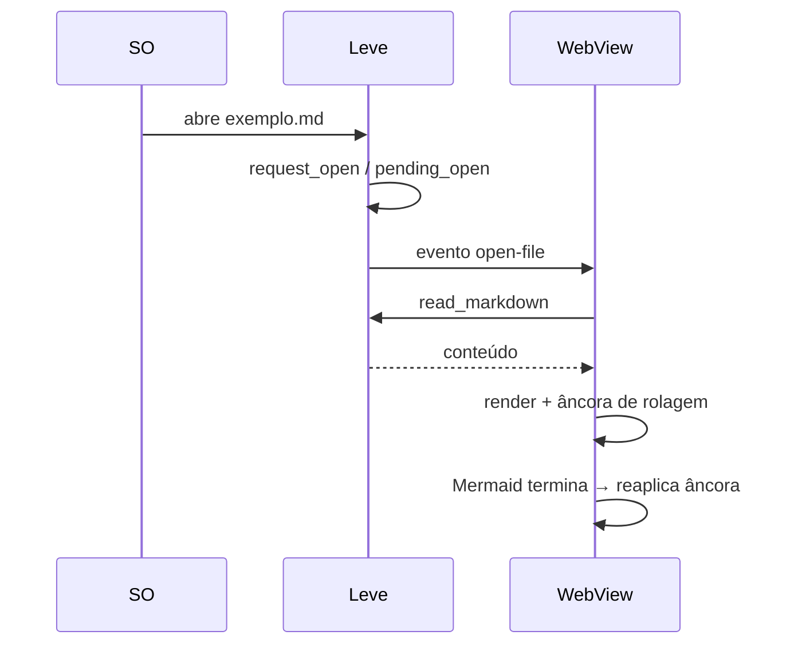
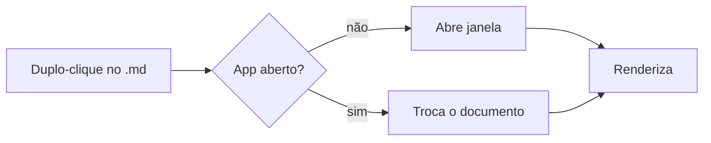

# Exemplo de documento

Este arquivo exercita o que o **Leve** renderiza. Edite e salve: a tela recarrega sozinha. Em **Exibir › Largura** e **Exibir › Fonte** você troca a medida da coluna (estreita, padrão, larga) e a família (sans, serif, mono); a escolha fica salva e o zoom continua valendo por cima.

## Texto e links

Parágrafo com *itálico*, **negrito**, `código inline`, ~~riscado~~ e um link externo para a [documentação do Tauri](https://tauri.app). Link interno para [a seção de tabelas](#tabelas) e para outro arquivo: [README do projeto](../README.md).

Nota de rodapé[^1].

[^1]: Rodapés funcionam via `markdown-it-footnote`.

## Fluxo de abertura

Diagrama logo no início: tudo abaixo dele muda de lugar quando o Mermaid termina, e a rolagem restaurada precisa acompanhar.



## Matemática

Inline: a energia é $E = mc^2$ e a área do círculo é $A = \pi r^2$. Cifrão solto não vira fórmula: custa $5 e $10, ou \$20 escapado.

$$
\int_0^\infty e^{-x^2}\,dx = \frac{\sqrt{\pi}}{2}
$$

Erro de sintaxe fica em vermelho sem quebrar a página: $\frac{a}{$ e também em bloco:

$$ \begin{matrix} 1 & 2 \\ 3 & 4 \end{matrix} \comandoInexistente $$

## Wikilinks

Links no estilo Obsidian resolvem na pasta do arquivo: [[assinatura]] abre `assinatura.md`, [[assinatura|Como assinar o app]] usa rótulo, [[assinatura#Windows (opcional)]] vai direto ao título e [[#Tabelas]] rola dentro deste documento. Nota inexistente fica apagada: [[nota-que-nao-existe]]. Embeds ficam fora de escopo e aparecem como texto: ![[imagem.png]].

## Lista de tarefas

- [x] Abrir por duplo-clique
- [x] Recarregar ao salvar
- [ ] Assinar e notarizar no Mac
- [ ] Assinar no Windows

## Código

```ts
export function slugify(s: string): string {
  return s.trim().toLowerCase().replace(/\s+/g, "-");
}
```

```bash
pnpm tauri dev -- -- docs/exemplo.md
```

Bloco sem linguagem (só o botão de copiar, sem rótulo):

```
pasta/
├── a.md
└── b.md
```

## Tabelas

| Recurso | Mac | Windows |
|---|:---:|:---:|
| Associação de `.md` | ✅ | ✅ |
| Recarga automática | ✅ | ✅ |
| Exportar PDF | ✅ | ✅ |

## Diagrama



## Alertas e callouts

> [!NOTE]
> Alertas no formato GitHub: `NOTE`, `TIP`, `IMPORTANT`, `WARNING`, `CAUTION`.

> [!TIP]
> Dicas aparecem em verde.

> [!IMPORTANT]
> Informação essencial para o leitor.

> [!WARNING]
> Algo que pede atenção antes de seguir.

> [!CAUTION]
> Consequências negativas de uma ação.

> [!info] Callout Obsidian com título
> Tipos do Obsidian (`info`, `hint`, `question`, `danger`, `bug`…) caem nos cinco estilos acima.

> [!faq]- Colapsado por padrão (marcador de menos)
> Este conteúdo começa escondido. Clique no título para abrir.

> [!success]+ Aberto por padrão (marcador de mais)
> Este começa aberto e pode ser recolhido.

> Citação comum continua como citação.

Diagrama com erro de sintaxe mostra a mensagem do parser e a fonte, sem afetar o diagrama acima:

```mermaid
flowchart LR
  A --> B
  B --> C[
```

## Citação e imagem

> "A simplicidade é a sofisticação máxima."


Imagem remota fica bloqueada até você pedir (aviso no topo do documento): 

Imagem que não existe vira aviso discreto com o texto alternativo e o caminho: 

### Subtítulo nível 3

#### Nível 4

Texto final para testar o sumário e a busca. Palavra-chave: **recarregar**.

