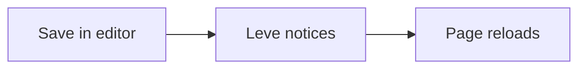

# Leve 0.2

Leve renders Markdown the way you expect, and **reloads on save**. Edit this file in any editor and watch it update.

> [!TIP]
> Use **View › Width** and **View › Font** to change the reading column. Your choice is remembered.

## What's inside

- [x] GitHub Flavored Markdown: tables, task lists, footnotes[^1]
- [x] Mermaid diagrams and KaTeX math, loaded only when a document uses them
- [ ] Your next idea

| Feature | Shortcut |
| --- | --- |
| Find in document | ⌘F |
| Contents | ⌘B |
| Settings | ⌘, |

## Diagram



## Code and math

```ts
export function greet(name: string): string {
  return `Hello, ${name}!`;
}
```

The area of a circle is $A = \pi r^2$.

[^1]: Footnotes work too.
