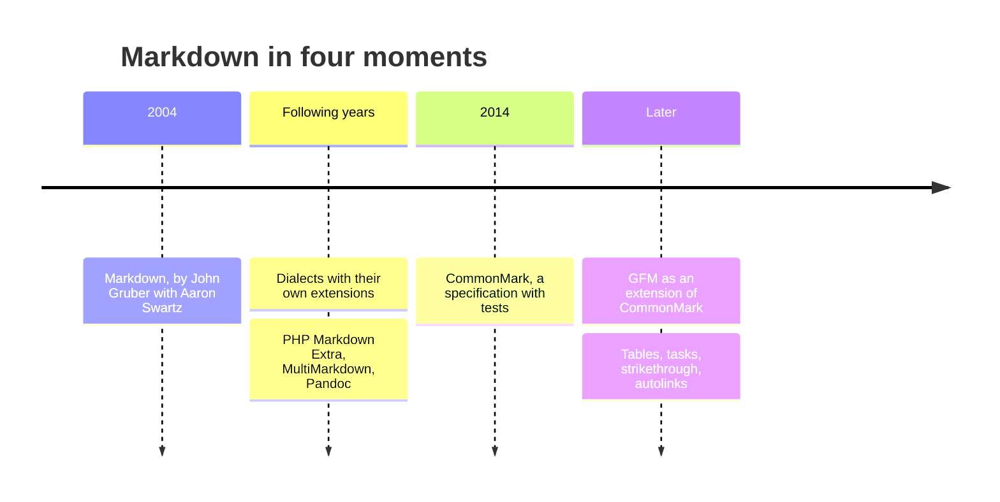
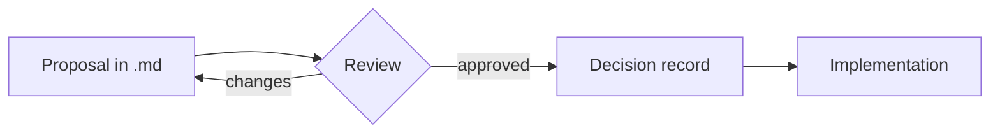

# Markdown Primer

Markdown is a way of writing formatted text with ordinary characters: a `#` becomes a heading, asterisks become emphasis, a dash becomes a list item. The file stays readable as plain text in any editor, and a program like this one turns the same file into a formatted page.

This primer covers where the format came from, the essential syntax, good practices, and the most common uses. Along the way, each feature shows up where it helps explain the topic.

> [!TIP]
> The panel on the left is the table of contents, built from this document's headings (**View › Contents** shows or hides it). To look for a word, use **Edit › Find…**; to open your own files, use **File › Open…** or drag a `.md` onto the window. The full list of shortcuts is in **Help › Keyboard Shortcuts**.

## A bit of history

Markdown was created in 2004 by **John Gruber**, with significant input from **Aaron Swartz** on the syntax. The idea was to take the conventions people already used in plain-text email (asterisks for emphasis, lines starting with `>` for quotes) and convert them to HTML. The first release was a description of the syntax plus a Perl script that did the conversion.

The original description left many cases open: what happens to lists inside quotes, how indentation is counted, where a block ends. Each implementation answered in its own way, and **dialects** appeared that also added features such as tables and footnotes: PHP Markdown Extra, MultiMarkdown, Pandoc's Markdown, and others. The same file could come out differently in each tool.

The answer was **CommonMark**, a detailed, unambiguous specification backed by a large test suite, launched in 2014[^name]. Soon after, **GitHub Flavored Markdown** (GFM) came to be defined as an extension of CommonMark, adding tables, task lists, strikethrough, and automatic links. Most current tools follow CommonMark, often with the GFM extensions.



What each generation added, in short:

| Feature | Original Markdown | CommonMark | GFM |
|---|:---:|:---:|:---:|
| Headings, lists, emphasis, links, code | ✅ | ✅ | ✅ |
| Unambiguous specification with tests | — | ✅ | ✅ |
| Tables | — | — | ✅ |
| Task lists | — | — | ✅ |
| ~~Strikethrough~~ | — | — | ✅ |
| Automatic links for bare URLs | — | — | ✅ |

[^name]: The initiative was announced under another name and became CommonMark after Gruber asked that "Markdown" not be used in its title.

## How to use it

The essential syntax fits on one screen. The block below shows what you type; the formatted result is what you are reading in this document.

```markdown
# Level 1 heading
## Level 2 heading

A paragraph with *italics*, **bold** and `code`.
A blank line separates paragraphs.

- list item
- another item
  - nested item (two spaces)

1. first step
2. second step

> Quote: start the line with >.

[link text](https://commonmark.org)


Three hyphens alone on a line become a horizontal rule:

---
```

Code between triple backticks becomes a block, and the language name right after the backticks turns on syntax highlighting:

```python
def reading_time(words: int, per_minute: int = 200) -> int:
    """Minutes to read a text, rounded up."""
    return -(-words // per_minute)
```

The estimate above is just a division, $t = \lceil w / s \rceil$, where $w$ is the word count and $s$ the reading speed. Formulas like this one, between dollar signs, are not part of CommonMark or GFM: they are a common extension in note-taking and technical documentation tools, and Leve draws them with KaTeX. As a block, with two dollar signs:

$$
\text{words per minute} = \frac{\text{words read}}{\text{minutes}}
$$

Footnotes are an extension too: the marker goes in the text and the note can sit anywhere in the file; the program moves it to the end[^footnote].

[^footnote]: Like this one. It was written right below the paragraph, but it shows up at the end of the document.

## Good practices

Markdown accepts almost anything, which is why a few shared habits pay off. They keep the file readable as text and predictable in any tool.

- **Headings in order.** A single `#` per document, and no skipped levels (from `##` to `###`, not to `####`). The table of contents and screen-reader navigation depend on it.
- **One idea per paragraph.** Short paragraphs are easier to read and to review. Many people also break the line after each sentence: the formatted result is the same, and diffs in version control get smaller.
- **Descriptive links.** Write [the CommonMark specification](https://spec.commonmark.org) instead of "click here": link text should make sense on its own.
- **Alt text on images.** What goes between the brackets of `![...]` is read by screen readers and shown when the image fails to load. Describe the content, not the file.
- **Short tables.** A good table fits the width of the screen and has cells of a few words. To explain something long, use a list.
- **Code blocks with a language.** ` ```bash `, ` ```json `, ` ```python `: besides the highlighting, the label tells the reader what to do with that snippet.
- **Front matter for metadata.** A YAML block between `---` at the top holds title, date, author, and tags without mixing them into the text. Static site generators and note-taking tools read this block; Leve shows it as the "Metadata" table at the top of this document.
- **Predictable file names.** Lowercase, no spaces, hyphens, and the `.md` extension: `style-guide.md`. Links between files stay simple and nothing breaks when you switch systems.
- **Version control.** Plain text and Git go well together: every change shows up line by line, and documentation can be reviewed the way code is.

> [!IMPORTANT]
> Before relying on an extension (tables, tasks, formulas, callouts), check that the tool where the file will be read understands it too. Anything it doesn't recognize shows up as plain text.

A task list makes a good checklist before publishing a document:

- [x] One level 1 heading, no skipped levels
- [x] Links whose text makes sense out of context
- [x] Images with alt text
- [ ] Code blocks labeled with their language
- [ ] Front matter with title and date
- [ ] Changes reviewed before the commit

## Where Markdown shows up

**READMEs and documentation.** `README.md` is the front door of nearly every software project, and platforms such as GitHub and GitLab show it already formatted. Whole documentation sites are written in Markdown and published as websites.

**Personal notes and knowledge bases.** Tools such as Obsidian and Logseq keep each note as a `.md` file in a folder you own, connected by *wikilinks*: `[[Note name]]` points to another note in the same folder, and `[[#Good practices]]` points to a heading in this document: try [[#Good practices]]. In a real file, Leve looks for the note in the document's folder; here, since this primer isn't in any folder, a link like [[My notes]] shows up dimmed, which is how Leve marks a note it couldn't find.

> [!info]- Why keep notes as `.md` files?
> A text file doesn't depend on any one app or company: it opens in any editor, goes into backups and version control, and stays readable for many years.

**Answers from AI assistants.** Chats with language models usually answer in Markdown, with headings, lists, tables, and code blocks. Saving the answer to a `.md` file keeps that structure, and a viewer shows the result the way it was meant to look.

**Blogs and static sites.** Generators such as Jekyll and Hugo turn a folder of `.md` files into a website. Front matter sets each page's title, date, and categories:

```yaml
---
title: First post
date: YYYY-MM-DD
tags: [markdown, blog]
---
```

**Specifications and decision records.** Engineering teams write technical proposals and architecture decision records (ADRs) in Markdown, next to the code, so the decision and its reasons are versioned in the same place. Text-based diagrams, like the Mermaid flow below, follow the same path:



**Presentations.** Tools such as Marp and reveal.js build slides from a Markdown file, with a separator between one slide and the next.

> [!WARNING]
> Markdown is great for structured text, but it doesn't replace a layout editor. When the exact position of each element matters (a poster, a printed form), use the right tool for that.

## Further reading

- [Original syntax, by John Gruber](https://daringfireball.net/projects/markdown/syntax)
- [CommonMark specification](https://spec.commonmark.org)
- [GitHub Flavored Markdown specification](https://github.github.com/gfm/)

External links open in your browser, never inside this window. This primer comes back whenever you want through **Help › Sample Document**, and it stops opening on its own if you turn off "Show sample document at startup" in **Settings**.
