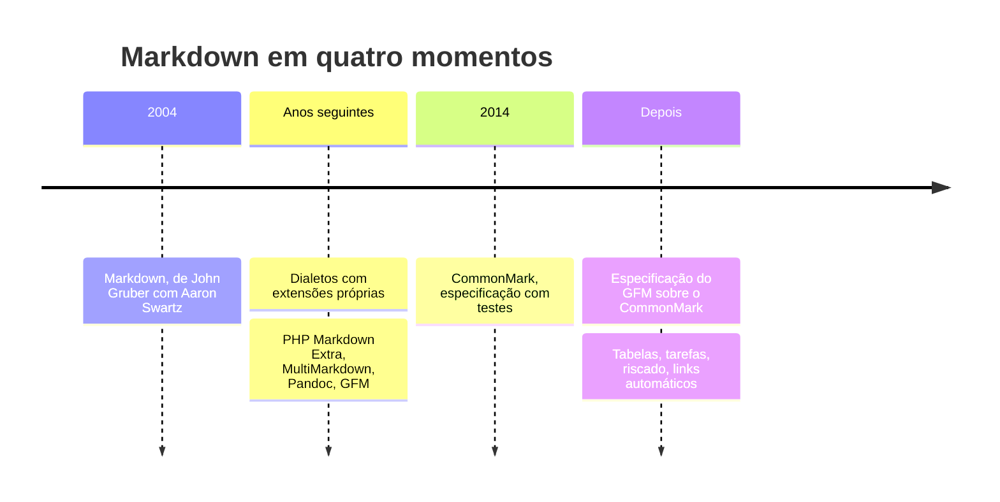
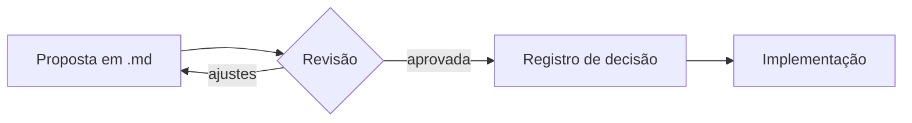

# Guia de Markdown

Markdown é um jeito de escrever texto formatado usando só caracteres comuns: um `#` vira título, asteriscos viram ênfase, um traço vira item de lista. O arquivo continua legível como texto puro, em qualquer editor, e um programa como este transforma o mesmo arquivo numa página formatada.

Este guia conta de onde o formato veio, mostra a sintaxe essencial, reúne boas práticas e passa pelos usos mais comuns. Ao longo do texto, cada recurso aparece onde ajuda a explicar o assunto.

> [!TIP]
> O painel à esquerda é o sumário, montado a partir dos títulos deste documento (**Exibir › Sumário** mostra ou esconde). Para procurar uma palavra, use **Editar › Buscar…**; para abrir os seus arquivos, **Arquivo › Abrir…** ou arraste um `.md` para a janela. A lista completa de atalhos fica em **Ajuda › Atalhos**.

## Um pouco de história

Markdown foi criado em 2004 por **John Gruber**, com contribuições importantes de **Aaron Swartz** na definição da sintaxe. A ideia era aproveitar as convenções que as pessoas já usavam em e-mails de texto puro (asteriscos para ênfase, linhas começando com `>` para citação) e convertê-las em HTML. A primeira versão era uma descrição da sintaxe acompanhada de um script em Perl que fazia a conversão.

A descrição original deixava vários casos em aberto: o que acontece com listas dentro de citações, como contar a indentação, onde termina um bloco. Cada implementação respondeu do seu jeito, e surgiram **dialetos** que também acrescentavam recursos, como tabelas e notas de rodapé: PHP Markdown Extra, MultiMarkdown, o Markdown do Pandoc e outros. O mesmo arquivo podia sair diferente em cada ferramenta.

Um dos dialetos mais usados é o **GitHub Flavored Markdown** (GFM), do GitHub, que somava tabelas, listas de tarefas, texto riscado e links automáticos. A resposta à fragmentação foi o **CommonMark**, uma especificação detalhada e sem ambiguidades, acompanhada de um grande conjunto de testes, lançada em 2014[^nome]. Mais tarde, o GitHub passou a definir o GFM formalmente como uma extensão do CommonMark. Boa parte das ferramentas atuais segue CommonMark, muitas vezes com as extensões do GFM.



O que cada geração acrescentou, de forma resumida:

| Recurso | Markdown original | CommonMark | GFM |
|---|:---:|:---:|:---:|
| Títulos, listas, ênfase, links, código | ✅ | ✅ | ✅ |
| Especificação sem ambiguidade, com testes | — | ✅ | ✅ |
| Tabelas | — | — | ✅ |
| Listas de tarefas | — | — | ✅ |
| ~~Texto riscado~~ | — | — | ✅ |
| Links automáticos para URLs soltas | — | — | ✅ |

[^nome]: A iniciativa foi anunciada com outro nome e passou a se chamar CommonMark depois que Gruber pediu que não usassem o nome Markdown.

## Como se usa

A sintaxe essencial cabe numa tela. O bloco abaixo mostra o que você digita; o resultado formatado é o que você está lendo neste documento.

```markdown
# Título de nível 1
## Título de nível 2

Parágrafo com *itálico*, **negrito** e `código`.
Uma linha em branco separa parágrafos.

- item de lista
- outro item
  - item aninhado (dois espaços)

1. primeiro passo
2. segundo passo

> Citação: comece a linha com >.

[texto do link](https://commonmark.org)


Três hifens sozinhos numa linha viram uma linha horizontal:

---
```

Código entre crases triplas vira bloco, e o nome da linguagem logo depois das crases liga o realce de sintaxe:

```python
def tempo_de_leitura(palavras: int, por_minuto: int = 200) -> int:
    """Minutos para ler um texto, arredondando para cima."""
    return -(-palavras // por_minuto)
```

A estimativa acima é só uma divisão, $t = \lceil p / v \rceil$, em que $p$ é o número de palavras e $v$ a velocidade de leitura. Fórmulas como essa, entre cifrões, não fazem parte do CommonMark nem do GFM: são uma extensão comum em ferramentas de notas e de documentação técnica, e o Leve as desenha com KaTeX. Em bloco, com dois cifrões:

$$
\text{palavras por minuto} = \frac{\text{palavras lidas}}{\text{minutos}}
$$

Notas de rodapé também são extensão: o marcador vai no texto e a nota pode ficar em qualquer lugar do arquivo, que o programa a leva para o fim[^rodape].

[^rodape]: Como esta. Ela foi escrita logo abaixo do parágrafo, mas aparece no fim do documento.

## Boas práticas

Markdown aceita quase tudo, e por isso vale combinar alguns hábitos. Eles deixam o arquivo legível como texto e previsível em qualquer ferramenta.

- **Títulos em hierarquia.** Um único `#` por documento e níveis sem pular (de `##` para `###`, não para `####`). O sumário e a navegação por leitor de tela dependem disso.
- **Uma ideia por parágrafo.** Parágrafos curtos são mais fáceis de ler e de revisar. Muita gente também quebra a linha a cada frase: o resultado formatado é o mesmo e as diferenças no controle de versão ficam menores.
- **Links descritivos.** Escreva [a especificação do CommonMark](https://spec.commonmark.org) em vez de "clique aqui": o texto do link deve fazer sentido sozinho.
- **Texto alternativo em imagens.** O que vai entre os colchetes de `![...]` é lido por leitores de tela e aparece quando a imagem não carrega. Descreva o conteúdo, não o arquivo.
- **Tabelas curtas.** Tabela boa cabe na largura da tela e tem células de poucas palavras. Para explicar algo longo, prefira uma lista.
- **Blocos de código com linguagem.** ` ```bash `, ` ```json `, ` ```python `: além do realce, a etiqueta diz ao leitor o que fazer com aquele trecho.
- **Front matter para metadados.** Um bloco YAML entre `---` no topo guarda título, data, autor e etiquetas sem misturar com o texto. Sites estáticos e ferramentas de notas leem esse bloco; o Leve o mostra como a tabela "Metadados" no topo deste documento.
- **Nomes de arquivo previsíveis.** Minúsculas, sem espaços, com hífen e extensão `.md`: `guia-de-estilo.md`. Links entre arquivos ficam mais simples e nada quebra ao trocar de sistema.
- **Controle de versão.** Texto puro combina com Git: cada mudança aparece linha a linha, e dá para revisar documentação como se revisa código.

> [!IMPORTANT]
> Antes de usar uma extensão (tabelas, tarefas, fórmulas, callouts), confira se a ferramenta onde o arquivo vai ser lido também a entende. O que não for reconhecido aparece como texto comum.

Uma lista de tarefas serve de checklist antes de publicar um documento:

- [x] Um título de nível 1 e níveis sem pular
- [x] Links com texto que faz sentido fora do contexto
- [x] Imagens com texto alternativo
- [ ] Blocos de código marcados com a linguagem
- [ ] Front matter com título e data
- [ ] Revisão das mudanças antes do commit

## Onde Markdown aparece

**README e documentação.** O `README.md` é a porta de entrada de quase todo projeto de software, e plataformas como GitHub e GitLab o mostram já formatado. Documentações inteiras são escritas em Markdown e publicadas como site.

**Notas pessoais e bases de conhecimento.** Ferramentas como Obsidian e Logseq guardam cada nota como um arquivo `.md` numa pasta sua, ligadas por *wikilinks*: `[[Nome da nota]]` aponta para outra nota da mesma pasta, e `[[#Boas práticas]]` aponta para um título deste documento: experimente [[#Boas práticas]]. Num arquivo de verdade, o Leve procura a nota na pasta do documento; aqui, como o guia não está em pasta nenhuma, um link como [[Minhas notas]] aparece apagado, que é como o Leve mostra uma nota que não encontrou.

> [!info]- Por que guardar notas em arquivos `.md`?
> Arquivo de texto não depende de um aplicativo nem de uma empresa: abre em qualquer editor, entra em backup e em controle de versão, e continua legível daqui a muitos anos.

**Respostas de assistentes de IA.** Chats com modelos de linguagem costumam responder em Markdown, com títulos, listas, tabelas e blocos de código. Salvar a resposta num `.md` preserva essa estrutura, e um visualizador mostra o resultado como ele foi pensado.

**Blogs e sites estáticos.** Geradores como Jekyll e Hugo transformam uma pasta de arquivos `.md` em site. O front matter define título, data e categorias de cada página:

```yaml
---
title: Primeiro post
date: AAAA-MM-DD
tags: [markdown, blog]
---
```

**Especificações e registros de decisão.** Times de engenharia escrevem propostas técnicas e registros de decisão de arquitetura (ADRs) em Markdown, junto do código, para que a decisão e o motivo fiquem versionados no mesmo lugar. Diagramas em texto, como o fluxo abaixo em Mermaid, seguem o mesmo caminho:



**Apresentações.** Ferramentas como Marp e reveal.js montam slides a partir de um arquivo Markdown, com um separador entre um slide e outro.

> [!WARNING]
> Markdown é ótimo para texto estruturado, mas não substitui um editor de layout. Quando a posição exata de cada elemento importa (um cartaz, um formulário impresso), use a ferramenta certa para isso.

## Para continuar

- [Sintaxe original, por John Gruber](https://daringfireball.net/projects/markdown/syntax)
- [Especificação do CommonMark](https://spec.commonmark.org)
- [Especificação do GitHub Flavored Markdown](https://github.github.com/gfm/)

Links externos abrem no seu navegador, nunca dentro desta janela. Este guia volta quando você quiser, por **Ajuda › Documento de exemplo**, e para de abrir sozinho se você desligar "Mostrar documento de exemplo ao abrir" nas **Preferências**.
