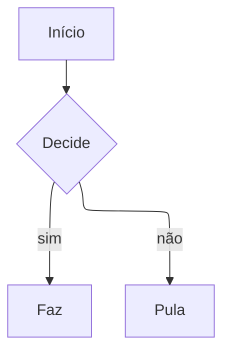
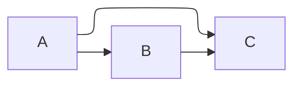
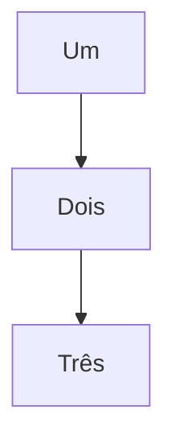
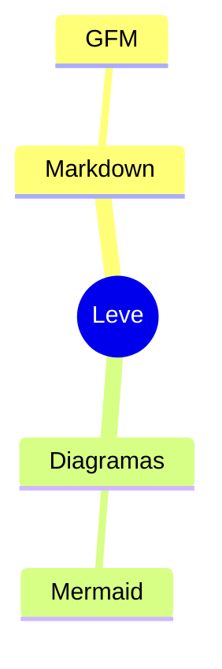
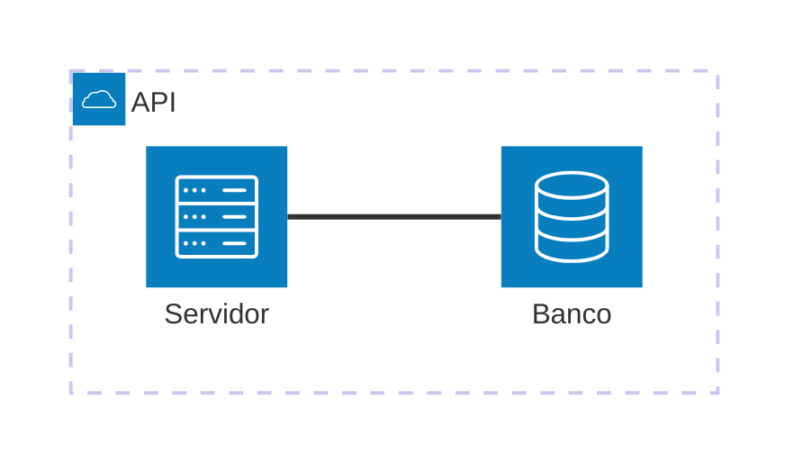

# Mermaid sem ELK

O layout ELK não entra no bundle (`mermaidSemElk` em `vite.config.ts`). Os dois primeiros diagramas pedem ELK e devem renderizar com dagre, sem bloco de erro e sem requisição a `elk`.

## flowchart-elk

## layout: elk no frontmatter

## Flowchart normal

## Mindmap

## architecture-beta

