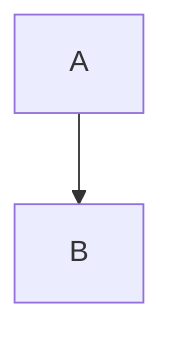

# Plano de migração

Documento para provar a revisão para IA: anotar, copiar, recarregar com a citação alterada.

## Rollout

A virada será feita em uma janela só, migrando todos os usuários de uma vez na sexta.

Depois da virada, migrando todos os usuários de uma vez deixa de ser opção.

## Custos

Tudo roda sem custo adicional no plano atual.

```ts
const janela = "sexta";
```

Fórmula: $x^2$ e diagrama:


